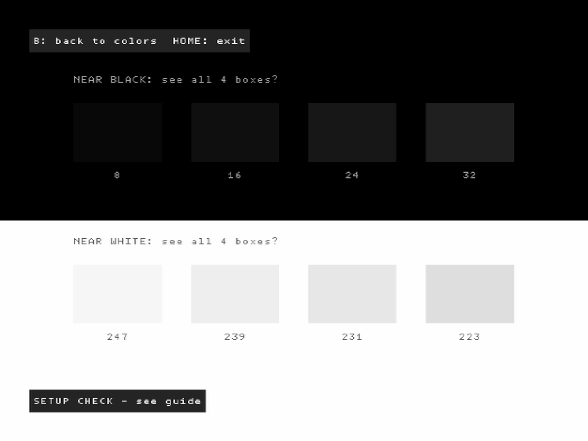

# AutoLUT Setup Guide

Step-by-step guide to capturing the calibration colors and generating your `LUT.png`. It follows the same steps as the guide inside AutoLUT (**Open guide** in the bottom bar). See [README.md](README.md) for what AutoLUT is and where to download it.

Pick your console:

- [Wii (AutoLUT Palette homebrew app)](#wii)
- [N64 (AutoLUT Palette ROM on a flashcart)](#n64)

Further down: [Troubleshooting](#troubleshooting) covers what AutoLUT's warnings and capture statuses mean.

## Wii

### Step 1: OBS setup - do this first

Incorrect OBS settings **will** force you to re-take all captures if you want optimal and accurate results, so follow these instructions closely. Mismatched color space settings distort colors before AutoLUT ever sees them.

**OBS Settings > Advanced > Video** (this is what modern streaming sites expect):

| Setting | Value |
|---|---|
| Color Space | **Rec. 709** |
| Color Range | **Limited** |

**Your capture source's Properties:**

| Setting | Value | Why |
|---|---|---|
| Color Space | **Rec. 601** | If that option exists. This is the color space the Wii and N64 output. |
| Resolution/FPS Type | **Custom** | |
| Resolution | **720x480** | Some capture card drivers (for example Elgato) otherwise force their own color range conversion on top of OBS's, doubling any mismatch; a custom resolution makes OBS take over the conversion completely. |
| Color Range | Leave as it is for now | The [check your color range](#step-3-check-your-color-range) step tells you whether to change it. |

### Step 2: Get the calibration colors onto your console

Download `AutoLUT-Palette-Wii-<version>.zip` from [releases](/../../releases/latest), extract it to the root of your SD card, then launch it from the Homebrew Channel. The desktop app also bundles it: **Copy app to clipboard** in AutoLUT's guide pastes it as an `apps` folder that merges with the `apps` folder already on your card. The web version has a download button in its guide.

### Step 3: Check your color range

The app opens on a setup check screen with four dark boxes on black and four light boxes on white. Look at it in the OBS preview, with the Apply LUT filter off if you already have one, and set **Color Range** in the capture source's **Properties**:

1. Set it to **Partial**. If all 8 boxes are visible, you're done.
2. If some boxes disappear into the background, set it to **Full** instead.

Always try Partial first: Full shows every box even when it's the wrong choice. If boxes disappear on both, recheck the custom 720x480 resolution from step 1.

A correct color range, every box visible:

Press **B** to go to the colors. B brings the check screen back at any time and returns you to the same color. Don't include the check screen in your calibration screenshots.

### Step 4: Screenshot all 39 colors

Step through the colors with **A** (or use **LEFT**/**RIGHT** to go back and forth) and screenshot each one - 39 colors, any order, any filenames. AutoLUT detects which color each screenshot shows automatically.

Screenshot the **raw capture source**: in OBS, right-click the source and use **Screenshot (Source)** with no filters. Do not edit or re-encode the files afterwards. Strongly recommended: bind a hotkey to **Screenshot Selected Source** (OBS Settings, Hotkeys) and keep your capture source selected - 39 screenshots through the right-click menu is a good way to lose your mind.

All 9 gray colors (including black and white) are required; at least 20 of the 39 colors must be identified. The palette app's corner label in the screenshots is fine - just keep the center of the screen clear: no watches or other overlays.

### Step 5: Load and generate

Click **Load images...**, or drag your screenshots (or the folder that holds them) and drop them anywhere in the AutoLUT window. Then click **Generate LUT** in the bottom left. Each screenshot gets matched to its color (shown as a swatch in the list); problems are reported per screenshot.

Check the result with **Show Corrected Image** - the corrected preview replicates OBS's Apply LUT filter exactly, so what you see is what OBS will render.

Screenshots from an earlier run stay loaded - click **Reset** first so they don't mix with the new ones.

### Step 6: Save and apply in OBS

Click **Save LUT.png** in the bottom left, then in OBS right-click your capture source, **Filters**, add **Apply LUT**, and select the file.

### Step 7: Crop and scale your game (optional)

Not relevant to AutoLUT itself, but recommended regardless: to crop and scale a 4:3 game optimally, never use OBS' transform features (drag to scale, alt-drag to crop) - use filters for everything, ordered:

1. **Apply LUT**
2. **Crop/Pad**
3. **Scaling/Aspect Ratio**

Set **Crop/Pad** per game with the game running, since games render at different resolutions (basically none use 640x480 or 320x240).

Set **Scaling/Aspect Ratio** to the 4:3 resolution that fills your canvas vertically - 1440x1080 on a 1920x1080 canvas - not just "4:3", with scale filtering on **Area**. Point also works for a really pixelated/harsh look, at the cost of uneven pixel row/column widths; never use the other scale filtering options here.

## N64

### Step 1: OBS setup - do this first

Incorrect OBS settings **will** force you to re-take all captures if you want optimal and accurate results, so follow these instructions closely. Mismatched color space settings distort colors before AutoLUT ever sees them.

**OBS Settings > Advanced > Video** (this is what modern streaming sites expect):

| Setting | Value |
|---|---|
| Color Space | **Rec. 709** |
| Color Range | **Limited** |

**Your capture source's Properties:**

| Setting | Value | Why |
|---|---|---|
| Color Space | **Rec. 601** | If that option exists. This is the color space the Wii and N64 output. |
| Resolution/FPS Type | **Custom** | |
| Resolution | **720x480** | Some capture card drivers (for example Elgato) otherwise force their own color range conversion on top of OBS's, doubling any mismatch; a custom resolution makes OBS take over the conversion completely. 720x480 is correct even for the N64: NTSC signal timings are fixed, so capture cards digitize any NTSC source to 720x480 regardless of the console's internal resolution. |
| Color Range | Leave as it is for now | The [check your color range](#step-3-check-your-color-range-1) step tells you whether to change it. |

### Step 2: Get the calibration colors onto your console

Download `AutoLUT-Palette-N64-<version>.z64` from [releases](/../../releases/latest), put it on your flashcart's SD card and boot it. The desktop app also bundles it: **Copy ROM to clipboard** in AutoLUT's guide lets you paste it wherever you see fit on the SD card. The web version has a download button in its guide.

### Step 3: Check your color range

The ROM opens on a setup check screen with four dark boxes on black and four light boxes on white. Look at it in the OBS preview, with the Apply LUT filter off if you already have one, and set **Color Range** in the capture source's **Properties**:

1. Set it to **Partial**. If all 8 boxes are visible, you're done.
2. If some boxes disappear into the background, set it to **Full** instead.

Always try Partial first: Full shows every box even when it's the wrong choice. If boxes disappear on both, recheck the custom 720x480 resolution from step 1.

A correct color range, every box visible (Wii app shown, the N64 ROM looks the same):

Press **B** to go to the colors. B brings the check screen back at any time and returns you to the same color. Don't include the check screen in your calibration screenshots.

### Step 4: Screenshot all 39 colors

Step through the colors with **A** (or use **LEFT**/**RIGHT** to go back and forth) and screenshot each one - 39 colors, any order, any filenames. AutoLUT detects which color each screenshot shows automatically.

Screenshot the **raw capture source**: in OBS, right-click the source and use **Screenshot (Source)** with no filters. Do not edit or re-encode the files afterwards. Strongly recommended: bind a hotkey to **Screenshot Selected Source** (OBS Settings, Hotkeys) and keep your capture source selected - 39 screenshots through the right-click menu is a good way to lose your mind.

All 9 gray colors (including black and white) are required; at least 20 of the 39 colors must be identified. The palette ROM's corner label in the screenshots is fine - just keep the center of the screen clear: no watches or other overlays.

### Step 5: Load and generate

Click **Load images...**, or drag your screenshots (or the folder that holds them) and drop them anywhere in the AutoLUT window. Then click **Generate LUT** in the bottom left. Each screenshot gets matched to its color (shown as a swatch in the list); problems are reported per screenshot.

Check the result with **Show Corrected Image** - the corrected preview replicates OBS's Apply LUT filter exactly, so what you see is what OBS will render.

Screenshots from an earlier run stay loaded - click **Reset** first so they don't mix with the new ones.

### Step 6: Save and apply in OBS

Click **Save LUT.png** in the bottom left, then in OBS right-click your capture source, **Filters**, add **Apply LUT**, and select the file.

### Step 7: Crop and scale your game (optional)

Not relevant to AutoLUT itself, but recommended regardless: to crop and scale a 4:3 game optimally, never use OBS' transform features (drag to scale, alt-drag to crop) - use filters for everything, ordered:

1. **Apply LUT**
2. **Crop/Pad**
3. **Scaling/Aspect Ratio**

Set **Crop/Pad** per game with the game running, since games render at different resolutions (basically none use 640x480 or 320x240).

Set **Scaling/Aspect Ratio** to the 4:3 resolution that fills your canvas vertically - 1440x1080 on a 1920x1080 canvas - not just "4:3", with scale filtering on **Area**. Point also works for a really pixelated/harsh look, at the cost of uneven pixel row/column widths; never use the other scale filtering options here.

## Troubleshooting

### The color range check screen

The numbers under the boxes are the 8-bit gray level the console outputs for each box. Most capture cards send limited range video, which Partial expands back to full range. Some send full range, and Partial then clips the darkest and brightest levels, so boxes 8 and 16 (and 247 and 239) disappear. Full never hides boxes on a limited range signal; it shows them all on a lifted, dark gray background instead, which is why Partial is the one to try first.

If boxes disappear on both settings, the capture driver applies its own range conversion on top of OBS's. Set **Resolution/FPS Type** to **Custom** and **Resolution** to **720x480** (step 1), then check again.

A slight lift in the black level is normal on some capture chains and AutoLUT corrects it. The boxes are there to catch the big range mismatches that lose detail for good.

The check screen only covers color range. A Rec. 601/709 color space mismatch doesn't show up on grays, so set that from step 1 as usual.

### Warnings and capture statuses

- More identified colors means better correction. If any colors are outliers, it's most likely a settings issue. In most cases a correct setup matches all 39, even on fairly messed up capture feeds.
- AutoLUT accepts any capture resolution - the Custom 720x480 setting is about keeping the driver's hands off the color range, not about what AutoLUT needs.
- If AutoLUT warns about washed-out or crushed colors, your capture device and OBS disagree on color range (full vs limited). Fix it in the capture source's **Properties** - set **Color Range** to 'Partial' for washed-out captures or 'Full' for crushed ones - then re-capture. Calibrating on a crushed capture loses shadow/highlight detail permanently, so always fix this first. It's possible for your capture to simply be crushed without it being a color range issue, but people mismatch their color range settings fairly often.
- A capture marked **excluded as outlier** (orange) was identified but disagreed with what all your other captures say about your capture chain, so it did not influence the LUT. One or two are harmless; re-capture them for maximum quality. Many outliers means something changed mid-capture (settings, input, lighting) - re-capture the whole set.
- Grays are held to a stricter standard: if the fit would leave any gray capture visibly tinted, AutoLUT refuses to generate the LUT. This almost always means an OBS or capture device settings mismatch (see step 1) - fix the settings and re-capture everything.
